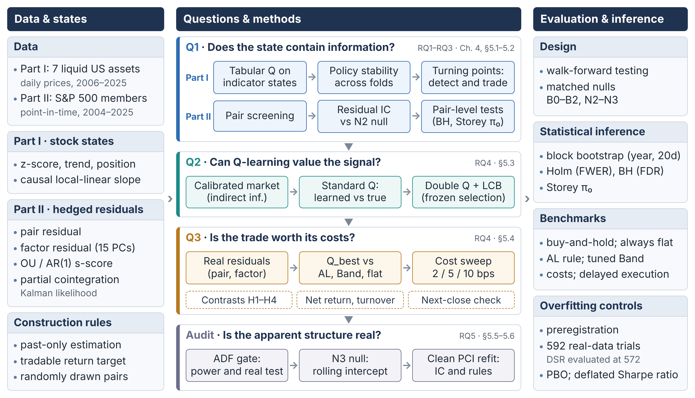
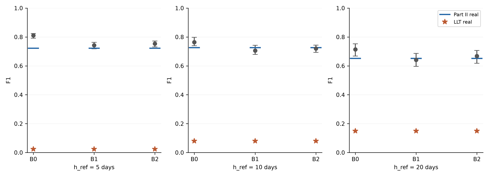
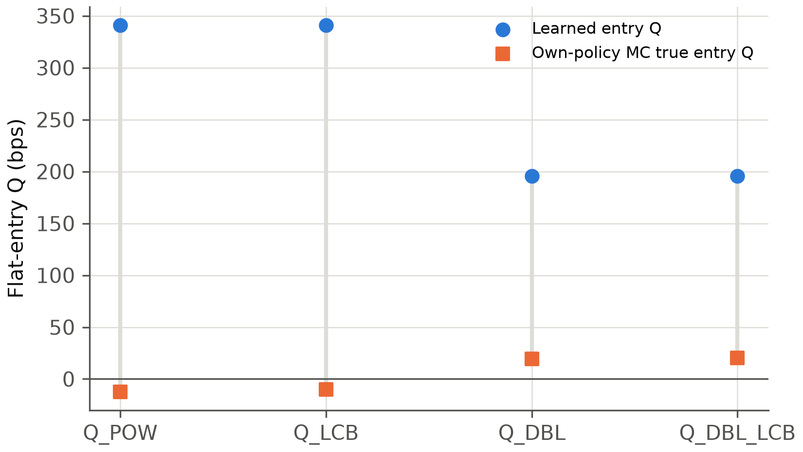

# Adaptive Pairs Trading via Reinforcement Learning

**A Statistical Study of Tabular Q-Learning on Single Stocks and Cointegration Residuals**

Ma Xiyao · ST4288 Honours Project in Statistics, National University of Singapore, 2026/27 · Supervisor: Prof. Xia Yingcun

The full thesis is available on request.

---

## The question

Many papers report that reinforcement-learning traders beat simple baselines, but those gains are hard to judge. Test periods are short, benchmarks are weak, and the number of configurations tried is rarely stated. This thesis asks:

> When can a tabular Q-learner learn a useful trading rule from daily US stock prices? When it cannot, is the limit in the **learning algorithm** or in the **information its state carries**?

I chose tabular Q-learning because its behaviour can be read state by state from a table of action values, so each failure can be traced to a specific cause. The study moves from **seven single assets** (Part I) to **S&P 500 stocks hedged against a partner or against 15 principal-component factors** (Part II, pairs trading and statistical arbitrage).

## How results were judged

- **Matched nulls.** Every main result is compared with a copy of the data that keeps volatility and the estimation procedure but removes the predictable direction of prices: B0–B2 for prices, N2–N3 for residuals. This separates real signal from structure that estimation creates even in pure noise.
- **Preregistration.** Hypotheses, test families and pass criteria were registered before computation.
- **Inference that respects dependence.** Walk-forward testing, 20-day and year-block bootstrap intervals, Holm (FWER) and Benjamini–Hochberg (FDR) corrections, and Storey's π₀.
- **Overfitting controls.** A deflated Sharpe ratio across the 572 real-data trials registered at evaluation, and the probability of backtest overfitting.
- **A calibrated synthetic market.** True action values are known in this market, so the learner's estimates can be checked against the truth.

## Findings

**1. Single stocks carry little usable direction.** Q-learning on indicator states never significantly beat buy-and-hold: 0 of 84 walk-forward tests, and none of the short-window or Holm-corrected extensions. Policies mostly stayed long, and their apparent exit rules did not persist. A causal turning-point detector reaches F1 ≈ 0.72, but it does just as well on direction-randomised series (below). Trading its confirmed turns lowers the Sharpe ratio by 0.28 (interval below zero), and still by 0.24 with zero costs.

**2. Hedged residuals carry a thin, short-lived reversal.** The 5-day excess information coefficient is 0.0094 for pair residuals and 0.0091 for factor residuals, with intervals well above zero. The tested screens could not identify the predictable pairs out of sample. An apparent one-month mean reversion turned out to be an artefact of rolling-intercept subtraction. I derived it analytically (eq. 5.1) and reproduced it with a matched null (N3).

**3. Standard Q-learning overestimates the value of trading.** This is maximisation bias. In the calibrated market, the learned value of entering is **341 bps against a true value of −12 bps**. Double Q-learning with a pessimistic (lower-confidence-bound) entry rule shrinks the gap. A decaying step size fixes a learner that had stopped trading in 11 of 22 years, adding 125 bps per pair-year (Holm p = 0.012).

**4. The repaired learner behaves sensibly on real data.** It stays out where the signal cannot pay for the hedge, and its turnover falls significantly as costs rise (Holm p < 0.001). It beats the Avellaneda–Lee rule on factor residuals (Holm p = 0.0008), but it does not consistently beat a threshold rule tuned to each cost.

**5. Standard statistical gates can hurt.** A rolling ADF stationarity gate would have blocked 87% of the rule's trades on pair residuals. Those trades earned +10.5 bps each (Holm p = 0.016), more than the trades it allowed. Statistical stationarity is not the same as reversion large enough to pay for trading.

**Bottom line.** No strategy passes the deflated Sharpe ratio. The conclusions therefore concern how learners behave relative to rules, not deployable profits. The contribution is the matched-null evaluation protocol and a diagnosis of *where* RL trading fails: in the data, in the learner, or in costs.

## Repository layout

The code is organised by thesis section.

| Section | Topic | Code |
|---|---|---|
| 4.1 | Q-learning on indicator states | [code/part1_single_stock/4.1_indicator_states](code/part1_single_stock/4.1_indicator_states) |
| 4.2 | Policy stability across folds | [code/part1_single_stock/4.2_policy_stability](code/part1_single_stock/4.2_policy_stability) |
| 4.3 | Real-time turning-point detection | [code/part1_single_stock/4.3_turning_points](code/part1_single_stock/4.3_turning_points) |
| 4.4 | Trading confirmed turns | [code/part1_single_stock/4.4_trading_turns](code/part1_single_stock/4.4_trading_turns) |
| 5.1 | Raw spreads and pair screening | [code/part2_pairs/5.1_raw_spreads](code/part2_pairs/5.1_raw_spreads) |
| 5.2 | Residual predictability vs matched null | [code/part2_pairs/5.2_residual_predictability](code/part2_pairs/5.2_residual_predictability) |
| 5.3 | Calibrated market, overestimation and repair | [code/part2_pairs/5.3_calibrated_market](code/part2_pairs/5.3_calibrated_market) |
| 5.4 | Learning on real residuals | [code/part2_pairs/5.4_residual_learning](code/part2_pairs/5.4_residual_learning) |
| 5.5 | Cointegration (ADF / variance-ratio) gates | [code/part2_pairs/5.5_cointegration_gates](code/part2_pairs/5.5_cointegration_gates) |
| 5.6 | Partial cointegration and the intercept artefact | [code/part2_pairs/5.6_partial_cointegration](code/part2_pairs/5.6_partial_cointegration) |
| — | Shared library (data, features, agents, execution, statistics) | [code/shared/fyp_rl](code/shared/fyp_rl) |
| — | Random-walk and synthetic-market simulations | [code/shared/simulations](code/shared/simulations) |

The simulation kernels for the calibrated market in Section 5.3 are written in C for speed.

## Notes on running the code

This is the research code as used for the thesis, published for transparency. It is not a packaged library.

- **Data are not included.** Prices are daily adjusted closes downloaded with `yfinance`; S&P 500 membership is point-in-time.
- **Paths.** Scripts keep the original absolute paths from the machine where the experiments ran. Each experiment also ran inside a provenance harness (hash-sealed inputs, preregistration and run receipts) that is not part of this repository, so scripts will need their paths and inputs adapted before rerunning.
- **Dependencies.** Python 3.13 (version used for the thesis runs), pandas, numpy, statsmodels, matplotlib, yfinance, exchange_calendars, and a C compiler for the Section 5.3 kernels.

## Citation

> Ma, X. (2026). *Adaptive Pairs Trading via Reinforcement Learning: A Statistical Study of Tabular Q-Learning on Single Stocks and Cointegration Residuals.* Honours thesis, Department of Statistics and Data Science, National University of Singapore.
